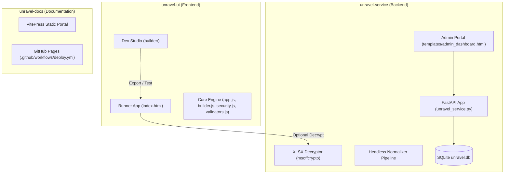

# Code Architecture & Function Overview

This document provides a comprehensive technical overview of Unravel's codebase, multi-repository architecture, and primary JavaScript / Python functions.

---

## Repository Architecture

Unravel is divided into three completely decoupled repositories:



```
repos/
├── unravel-ui/                        # Standalone 100% Client-Side Web Application
│   ├── index.html                     # Primary Ingestion Wizard UI
│   ├── builder/
│   │   └── index.html                 # Dev Studio Schema Builder UI
│   ├── manifest.webmanifest           # PWA installation manifest
│   ├── sw.js                          # Service Worker for offline execution
│   └── assets/
│       ├── css/style.css              # Main application stylesheet & design tokens
│       ├── js/
│       │   ├── app.js                 # Core Wizard Engine (UnravelApp)
│       │   ├── builder.js             # Visual Schema Builder (UnravelBuilder)
│       │   ├── security.js            # Web Crypto AES-GCM Browser Vault (UnravelSecurity)
│       │   └── validators.js          # Rule Validation Engine (UnravelValidator)
│       ├── sample-data/               # Sample schemas, starter templates, test files
│       ├── icons/                     # Standard SVG & PNG application icons
│       └── vendor/                    # Self-contained offline JS/CSS libraries
│
├── unravel-service/                   # Headless Microservice & Companion Gateway
│   ├── unravel_service.py             # FastAPI Decryption Gateway, Normalizer & Admin API
│   ├── templates/                     # Jinja2 HTML templates for status & admin console
│   │   ├── base.html                  # Master Bootswatch Lumen layout
│   │   ├── status.html                # Public health & status page
│   │   └── admin_dashboard.html       # Schema CRUD & telemetry console
│   ├── assets/                        # Local CSS/JS vendor assets for admin dashboard
│   ├── unravel.db                     # SQLite database repository for project schemas & audit logs
│   ├── requirements.txt               # Python package dependencies
│   ├── Dockerfile                     # Container definition
│   └── docker-compose.yml             # Local production composition
│
└── unravel-docs/                      # Documentation Portal
    ├── index.md                       # VitePress landing homepage
    ├── .vitepress/config.mjs          # VitePress configuration & local search setup
    ├── public/                        # Logo, favicon, and .nojekyll flag
    └── *.md                           # User, developer, deployment & security guides
```

---

## 1. `unravel-ui/assets/js/app.js` (`UnravelApp`)

The main wizard controller managing the pipeline, spreadsheet parsing, row filters, calculated fields, cell transformations, validation execution, interactive grid rendering, and exports.

### State & Properties
- `this.currentStep`: Active wizard step index (1 through 8).
- `this.schema`: Current active JSON schema project configuration.
- `this.rawWorkbook`: Parsed SheetJS workbook instance in browser RAM.
- `this.rawSheetData`: 2D array of extracted worksheet/file rows before offset.
- `this.cleanRecords`: Processed, transformed, and validated canonical records.
- `this.excludedRecords`: Array of rows excluded by Ingestion Row Filters with itemized reasons.
- `this.validationErrors`: Map of row and column errors with severity levels.
- `this.activeFilter`: Current grid view filter (`'all'`, `'valid'`, `'errors'`).
- `this.selectedRowIndices`: Set of row indices marked for bulk deletion.

### Core Methods

| Method | Description |
| :--- | :--- |
| `init()` | Initializes the application, attaches DOM event listeners, and attempts to load cached schema from local storage. |
| `setupEventListeners()` | Binds ribbon buttons, file drag-and-drop dropzones, stepper buttons, and export triggers. |
| `navigateToStep(stepNumber)` | Transitions the wizard to the requested step, updating step indicators, validation guards, and visibility overlays. |
| `attemptAutoAdvance()` | Checks whether prerequisites for following steps are satisfied and advances the user automatically without unnecessary clicks. |
| `handleFileUpload(file)` | Validates uploaded file MIME type and extension, checks provider expectations, and passes file to parser. |
| `parseSpreadsheet(fileData)` | Uses SheetJS (`XLSX.read`) or PapaParse to parse raw bytes into rows. Detects password-protected workbooks. |
| `decryptEncryptedWorkbook(file, password)` | Sends base64 workbook to the Decryption Gateway and loads the returned decrypted workbook. |
| `executeOffsetDetection()` | Scans the 2D raw data matrix to automatically find header rows and compute X/Y offset coordinates. |
| `evaluateRowFilters(rows)` | Evaluates multi-condition pre-validation filters (`=`, `!=`, `>`, `>=`, `<`, `<=`) to include or exclude rows. |
| `evaluateCalculatedColumns(row)` | Evaluates tokenized formulas (e.g. `[sale_qty] * [sale_unit_price]`) to compute virtual columns dynamically. |
| `applyTransform(value, transformConfig)` | Applies sequential transformation steps (`CAST_STRING`, `CAST_FLOAT`, `CAST_INTEGER`, `CAST_DATE`, `TRIM`, `UPPERCASE`, `LOWERCASE`). |
| `runValidationPipeline()` | Maps columns, evaluates validation rules, handles ignorable fallbacks to default values, and records diagnostics. |
| `renderInteractiveGrid()` | Generates the Excel-like spreadsheet table, complete with row checkboxes, error highlighting, and cell edit listeners. |
| `setGridFilter(filterMode)` | Switches between `'all'`, `'valid'`, and `'errors'` row display modes without mutating underlying data. |
| `exportCleanJSON()` | Formats and triggers download of the valid records as a formatted `.json` file. |
| `exportCleanCSV()` | Generates RFC 4180 compliant CSV using PapaParse and triggers browser download. |
| `exportCleanXLSX()` | Builds a new SheetJS workbook and exports a `.xlsx` file. |
| `exportExcludedRowsCSV()` | Generates and downloads a `.csv` file of all filtered/excluded rows with their rejection reasons. |
| `dispatchToApi()` | Sends a POST request with the clean dataset to the destination API endpoint using the configured Bearer token. |
| `closeProject()` | Resets all in-memory state, purges localStorage cache, and returns to Step 1. |

---

## 2. `unravel-ui/assets/js/builder.js` (`UnravelBuilder`)

The visual schema authoring engine powering Developer Studio.

### Core Methods

| Method | Description |
| :--- | :--- |
| `init()` | Loads starter templates, initializes empty/cached schema, and renders Dev Studio panels. |
| `renderTargetColumns()` | Renders the target schema toolbar rows: Required toggle, Display Label, Default Value, Validations button, Transformations button, and Delete bin. |
| `addNewTargetColumn()` | Appends a new target destination column and synchronizes layout mappings. |
| `openValidationModal(colIdx)` | Configures default validation rules (`IsNHSNumber`, `IsPostcode`, `IsEmail`, `MatchRegex`, etc.) for a column. |
| `openTransformModal(colIdx)` | Configures sequential type casting and string transformation pipelines for a column. |
| `renderCalculatedColumns()` | Renders virtual formula field controls with bracketed token syntax (`[column_id]`). |
| `renderRowFilters()` | Renders pre-validation ingestion filter conditions and logical combine mode (`AND` / `OR`). |
| `pushHistory()` | Captures current schema state onto the undo stack and enables ribbon controls. |
| `undo()` / `redo()` | Traverses schema modification history (`Ctrl+Z`, `Ctrl+Y`). |
| `toggleJsonPreview()` | Collapses or expands the live JSON schema preview sidebar. |
| `handleAutoScaffold(file)` | Parses an uploaded sample spreadsheet or CSV, samples column headers and types, and scaffolds target columns. |
| `validateSchema()` | Diagnoses schema configuration for duplicate keys, missing IDs, or malformed slugs. |
| `downloadJSON()` | Serializes current schema to JSON and triggers browser download. |
| `launchInRunner()` | Saves schema to `localStorage` and redirects browser to runner with schema pre-loaded. |

---

## 3. `unravel-ui/assets/js/security.js` (`UnravelSecurity`)

Client-side cryptographic vault implementing standard Web Crypto API primitives.

### Core Methods

| Method | Description |
| :--- | :--- |
| `hasVaultPassword()` | Returns `true` if a master vault password has been initialized on the current browser. |
| `isSessionUnlocked()` | Checks if the current session tab has verified the vault password. |
| `deriveKey(password, salt)` | Derives a 256-bit AES-GCM key from user password and salt using PBKDF2 (100,000 iterations of SHA-256). |
| `setupVaultPassword(password)` | Initializes a fresh vault, generates a cryptographically random salt, and stores a verification token. |
| `verifyPassword(password)` | Validates the user's password against the stored encrypted verification token. |
| `encryptData(plaintext, password)` | Encrypts arbitrary strings or JSON objects with AES-GCM using a unique 12-byte initialization vector (IV). |
| `decryptData(ciphertext, password)` | Decrypts AES-GCM ciphertext blocks back into UTF-8 plaintext. |
| `lockSession()` | Clears session tokens from `sessionStorage`, locking cached projects. |

---

## 4. `unravel-ui/assets/js/validators.js` (`UnravelValidator`)

Zero-dependency validation rule engine.

### Core Methods

| Method | Description |
| :--- | :--- |
| `validate(value, ruleConfig)` | Master dispatcher routing a cell value to the appropriate validation check. |
| `notEmpty(val)` | Asserts value is not null, undefined, or empty whitespace. |
| `isEmail(val)` | Validates standard email address formats. |
| `isPostcode(val)` | Validates UK postal codes using official alphanumeric patterns. |
| `isPhoneNumber(val)` | Validates domestic and international telephone numbers. |
| `isNumber(val)` | Validates integers and decimal floating-point numbers. |
| `isInteger(val)` | Validates whole numbers. |
| `isAlphanumeric(val)` | Validates strings consisting solely of letters and digits. |
| `matchRegex(val, pattern, msg)` | Evaluates a value against an arbitrary regular expression pattern. |
| `isNHSNumber(val)` | Executes Modulus 11 checksum verification for 10-digit UK NHS numbers. |

---

## 5. `unravel-service/unravel_service.py`

Independent FastAPI microservice for password-protected Excel workbook decryption, project schema hosting, headless validation parsing, and Bootswatch telemetry admin console.

### Key Endpoints
- `GET /`: Operational status page displaying live uptime.
- `GET /health`: Health-check endpoint returning service capabilities and database status.
- `GET /admin`: Bootswatch Lumen Admin Dashboard displaying telemetry stats, usage metrics, and audit logs.
- `POST /admin/projects/save`: Admin-only project schema creation and modification.
- `POST /admin/projects/delete`: Admin-only project schema deletion.
- `POST /admin/logs/purge`: Purges operational audit logs with confirmation.
- `POST /api/decrypt-xlsx`: In-memory workbook decryption gateway via `msoffcrypto`.
- `POST /api/decrypt-xlsx-hybrid`: Zero-trust hybrid encrypted decryption (RSA-OAEP + AES-GCM).
- `GET /api/projects`: Public project schema retrieval repository.
- `POST /api/parse`: Headless parsing, row filtering, calculated field evaluation, and validation engine for automations.
- `POST /api/telemetry/session`: Anonymized validation error logging.
