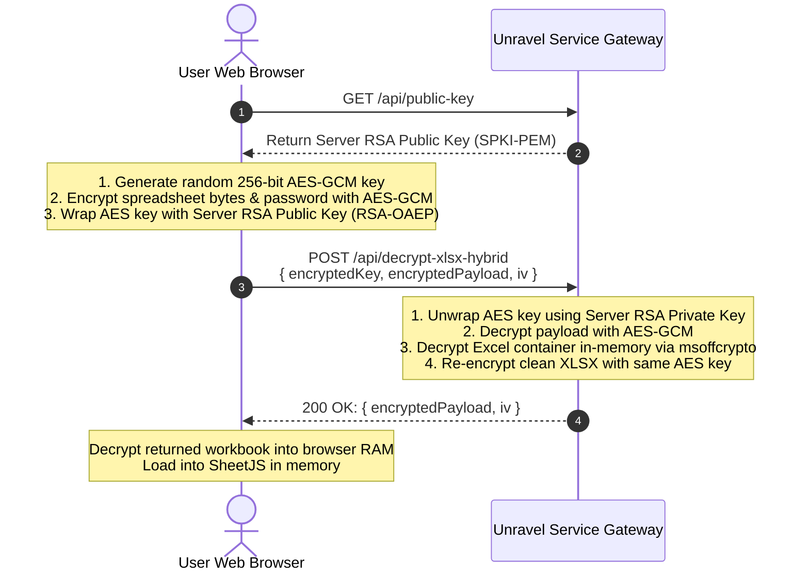

# Add-On: XLSX Decryption Gateway & Hybrid In-Transit Encryption

**Unravel** operates 100% inside the browser for standard CSV, TSV, and unencrypted XLSX spreadsheets.

However, Microsoft Excel password-protected workbooks (`.xlsx` using Agile Encryption or legacy Standard 40/128-bit encryption) require specialized cryptographic parsing of the compound document structure (OLE2/CFB). Because pure client-side JavaScript libraries have limited support for these proprietary office containers, Unravel includes an **optional Python FastAPI Decryption Gateway**.

> [!IMPORTANT]
> **Cloud Transmission & Optional Notice**: Unlike core Unravel ingestion (which executes 100% in local browser RAM), the Decryption Gateway transmits the encrypted workbook over HTTP/HTTPS to the configured service endpoint (which may be hosted in your cloud, on an intranet server, or locally). **Using this service is entirely optional.** Standard unencrypted XLSX, CSV, and TSV files never use this service and remain 100% inside your local browser.

---

## 1. Are Files Encrypted in Transit?

- **Over HTTPS (Transport Layer Security)**: If your decryption endpoint is accessed via `https://...`, all HTTP headers, request paths, and JSON payloads are encrypted in transit via TLS 1.3/1.2 using ephemeral Diffie-Hellman key exchange (ECDHE) and symmetric ciphers (AES-GCM or ChaCha20-Poly1305).
- **Over Plaintext HTTP**: If you deploy on `http://127.0.0.1:8001`, traffic stays on the local OS loopback and does not traverse the physical network. However, if deployed over plaintext HTTP across a local network without TLS, the bytes are only base64 encoded and are not encrypted against network sniffers.
- **Application-Layer Payload Encryption**: For zero-trust cloud deployments (where you want to prevent intermediate reverse proxies, corporate TLS inspection middleboxes, or WAFs from inspecting the raw spreadsheet bytes or workbook password), Unravel provides **Hybrid End-to-End In-Transit Encryption**.

---

## 2. Establishing Browser-to-Server Encryption: Why RSA + AES (Hybrid Encryption)?

### Why Can't We Use Pure RSA for the Entire File?
A common question is whether the browser can encrypt the entire Excel spreadsheet using the server's RSA public key.

**Pure RSA cannot encrypt files of arbitrary size.** Under standard RSA with Optimal Asymmetric Encryption Padding (OAEP):
$$\text{Max Payload Bytes} = \text{Key Length in Bytes} - 2 \times \text{Hash Output Length} - 2$$

- For **RSA-2048 with SHA-256**: $256 - 2 \times 32 - 2 = 190 \text{ bytes}$.
- For **RSA-4096 with SHA-256**: $512 - 2 \times 32 - 2 = 446 \text{ bytes}$.

Because an Excel spreadsheet is typically several megabytes, attempting to encrypt it directly with RSA will throw an error: `Data too long for key size`.

### The Cryptographic Standard: Hybrid Encryption (RSA-OAEP + AES-256-GCM)
Hybrid encryption is the standard used by PGP/GPG, JSON Web Encryption (JWE / RFC 7516), and TLS itself:
1. **Server Key Pair**: The decryption service maintains an asymmetric RSA key pair (2048-bit or 4096-bit) and shares the public key via `GET /api/public-key`.
2. **Ephemeral AES Key**: The browser generates a cryptographically random, single-use 256-bit symmetric session key (`AES-GCM`) via the W3C Web Crypto API.
3. **Payload Encryption**: The browser encrypts the spreadsheet bytes and password using AES-256-GCM with a random 12-byte initialization vector (IV).
4. **Key Wrapping**: The browser encrypts the 32-byte AES key using the server's RSA public key (`RSA-OAEP` with SHA-256).
5. **Transit & Decryption**: The server uses its RSA private key to unwrap the AES session key, decrypts the payload with AES-GCM, performs in-memory Excel decryption via `msoffcrypto`, and re-encrypts the result using the same AES key before returning it.



---

## 3. Requirements & Installation

The gateway is located at `repos/unravel-service/unravel_service.py`.

### Prerequisites
- Python 3.9+
- Dependencies listed in `repos/unravel-service/requirements.txt`:
  ```bash
  cd repos/unravel-service
  pip install -r requirements.txt
  ```

---

## 4. Running the Service

### Development Mode
```bash
cd repos/unravel-service
python3 unravel_service.py
```
Service runs on `http://127.0.0.1:8000`.

### Health Check
```bash
curl http://127.0.0.1:8000/health
```
Response:
```json
{
  "status": "online",
  "service": "Unravel XLSX Decryptor",
  "hybridEncryptionAvailable": true
}
```

---

## 5. API Endpoints Reference

### 1. `GET /api/public-key`
Returns the server's RSA public key in PEM format for browser key-wrapping.

#### Response (`200 OK`)
```json
{
  "algorithm": "RSA-OAEP-256",
  "format": "SPKI-PEM",
  "publicKey": "-----BEGIN PUBLIC KEY-----\nMIIBIjANBgkqhkiG9w0BAQEFAAOCAQ8AMIIBCgKCAQEA...\n-----END PUBLIC KEY-----\n"
}
```

---

### 2. `POST /api/decrypt-xlsx-hybrid` (End-to-End Encrypted Transit)

#### Request Body
```json
{
  "encryptedKey": "<base64_rsa_oaep_encrypted_aes_key>",
  "encryptedPayload": "<base64_aes_gcm_encrypted_json_payload>",
  "iv": "<base64_12_byte_initialization_vector>"
}
```

#### Successful Response (`200 OK`)
```json
{
  "success": true,
  "encryptedPayload": "<base64_aes_gcm_encrypted_decrypted_workbook>",
  "iv": "<base64_12_byte_return_iv>"
}
```

---

### 3. `POST /api/decrypt-xlsx` (Standard TLS Transit)

#### Request Body
```json
{
  "fileData": "<base64_encoded_encrypted_xlsx>",
  "password": "workbook_password_here"
}
```

#### Successful Response (`200 OK`)
```json
{
  "success": true,
  "fileData": "<base64_encoded_decrypted_xlsx>"
}
```

---

## 6. Configuring Endpoints in `app/config.json`

To switch between standard loopback decryption and hybrid cloud decryption, edit `app/config.json`:

```json
{
  "endpoints": {
    "decryptionServiceUrl": "http://127.0.0.1:8001/api/decrypt-xlsx-hybrid"
  },
  "features": {
    "enableHybridEncryption": true
  }
}
```

---

## 7. Production Systemd Daemon (Linux)

Create `/etc/systemd/system/unravel-decryptor.service`:

```ini
[Unit]
Description=Unravel Service (Decryption, Headless Parser & Broker)
After=network.target

[Service]
User=www-data
WorkingDirectory=/var/www/unravel/services
ExecStart=/usr/local/bin/uvicorn unravel_service:app --host 0.0.0.0 --port 8001 --workers 2
Restart=always
RestartSec=3
Environment="PYTHONUNBUFFERED=1"
Environment="UNRAVEL_MASTER_PASSWORD=your-secure-password"

[Install]
WantedBy=multi-user.target
```

Enable and start:
```bash
sudo systemctl daemon-reload
sudo systemctl enable unravel-service
sudo systemctl start unravel-service
```

---

## 7. Unravel Service: Docker / Podman Compose Deployment

Unravel Service can be hosted instantly using Docker or Podman Compose:

```yaml
version: '3.8'

services:
  unravel-service:
    build:
      context: .
      dockerfile: services/Dockerfile
    container_name: unravel-service
    restart: unless-stopped
    ports:
      - "8001:8001"
    environment:
      - UNRAVEL_HOST=0.0.0.0
      - UNRAVEL_PORT=8001
      - UNRAVEL_MASTER_PASSWORD=unravel2026
      - UNRAVEL_DB_PATH=/app/data/unravel.db
    volumes:
      - unravel_data:/app/data

volumes:
  unravel_data:
    name: unravel_data
```

Start container:
```bash
podman-compose up -d --build
# or
docker compose up -d --build
```

### Endpoints Overview
| Method | Path | Description | Zero-Trust Guarantee |
|---|---|---|---|
| `GET` | `/health` | Health check & feature flags | No data accessed |
| `GET` | `/api/public-key` | RSA public key for hybrid transit | Public key only |
| `POST` | `/api/decrypt-xlsx` | Standard in-memory XLSX decryptor | In-memory RAM only |
| `POST` | `/api/decrypt-xlsx-hybrid` | Hybrid RSA-OAEP/AES-GCM decryptor | End-to-end encrypted |
| `GET` | `/api/projects` | List hosted schemas in SQLite | Schema metadata |
| `GET` | `/api/projects/{id}` | Fetch project JSON (`/#/project/<id>`) | Schema definition |
| `POST` | `/api/parse` | Headless in-memory parser for automations | In-memory RAM only |
| `POST` | `/api/broker/dispatch` | Live forwarder to destination URL | No payload saved to DB |
| `POST` | `/api/telemetry/session` | Error session telemetry monitor | Only rule failure stats |
| `GET` | `/api/telemetry/stats` | Operator telemetry metrics | Aggregated metrics |

