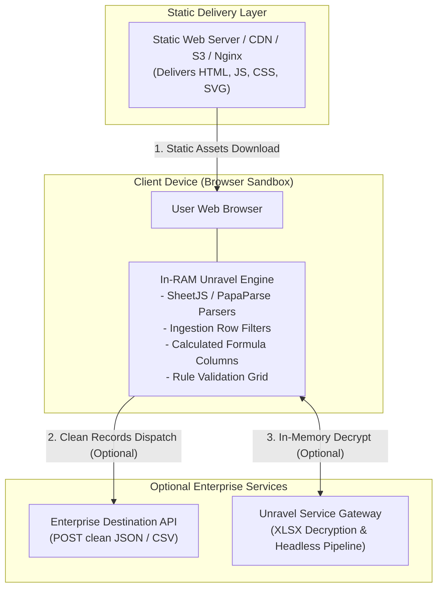

# Deployment Guide

**Unravel UI** consists purely of client-side static assets (HTML, CSS, JavaScript, and SVG icons). It has **zero server-side runtime dependencies** and **zero external CDN calls**.

This architecture simplifies deployment, ensures zero maintenance downtime, and allows installation in air-gapped, high-security enterprise intranets.

---

## 1. Hosting Architecture Overview



---

## 2. Docker Deployment

### Unravel UI (Static Frontend)

A lightweight Nginx Alpine container provides an ideal containerized deployment for `unravel-ui`.

#### `Dockerfile`
```dockerfile
FROM nginx:alpine

# Remove default nginx welcome page
RUN rm -rf /usr/share/nginx/html/*

# Copy Unravel UI static files
COPY . /usr/share/nginx/html

# Expose web port
EXPOSE 80

CMD ["nginx", "-g", "daemon off;"]
```

#### Build & Run
```bash
cd repos/unravel-ui
docker build -t unravel-ui:latest .
docker run -d -p 8080:80 --name unravel-ui unravel-ui:latest
```
Access the application at `http://localhost:8080`.

### Unravel Service (Backend & Decryption Gateway)

The companion Python service includes its own `Dockerfile` and `docker-compose.yml`:

```bash
cd repos/unravel-service
docker compose up -d --build
```
Access service health and the Admin Dashboard at `http://localhost:8000`.

---

## 3. Production Nginx Configuration

Below is a production-grade Nginx configuration with strict HTTP security headers and caching rules:

```nginx
server {
    listen 80;
    server_name unravel.yourdomain.internal;
    root /var/www/unravel-ui;
    index index.html;

    # Gzip Compression
    gzip on;
    gzip_types text/plain text/css application/json application/javascript text/xml application/xml;

    # Security Headers
    add_header X-Frame-Options "SAMEORIGIN" always;
    add_header X-Content-Type-Options "nosniff" always;
    add_header X-XSS-Protection "1; mode=block" always;
    add_header Referrer-Policy "strict-origin-when-cross-origin" always;
    
    # Strict Content Security Policy (No external CDN dependencies)
    add_header Content-Security-Policy "default-src 'self'; script-src 'self' 'unsafe-eval' 'unsafe-inline'; style-src 'self' 'unsafe-inline'; font-src 'self' data:; img-src 'self' data: blob:; connect-src 'self' http://localhost:8000 https:;" always;

    # Cache static assets
    location ~* \.(css|js|woff2?|svg|png|jpg|ico)$ {
        expires 7d;
        add_header Cache-Control "public, no-transform";
    }

    # SPA routing fallback
    location / {
        try_files $uri $uri/ /index.html;
    }
}
```

---

## 4. Static Hosting Platforms

### AWS S3 + CloudFront
1. Create an S3 bucket configured for Static Website Hosting.
2. Sync the `unravel-ui/` files:
   ```bash
   aws s3 sync ./repos/unravel-ui s3://my-unravel-bucket --delete
   ```
3. Attach a CloudFront distribution with an SSL certificate.

### Vercel
Create a `vercel.json` in `unravel-ui`:
```json
{
  "version": 2,
  "cleanUrls": true,
  "routes": [
    { "src": "/builder/(.*)", "dest": "/builder/$1" },
    { "src": "/assets/(.*)", "dest": "/assets/$1" },
    { "src": "/(.*)", "dest": "/$1" }
  ]
}
```

### Netlify
Create a `netlify.toml` in `unravel-ui`:
```toml
[build]
  publish = "."
```

---

## 5. Air-Gapped & Offline Deployment

Unravel is **100% self-contained**:
- All vendor libraries (`bootstrap`, `sheetjs`, `papaparse`, `sweetalert2`, `moment`, `bootstrap-icons`) reside under `assets/vendor/`.
- No Google Fonts, external CDN scripts, or third-party telemetry pings are made.
- Can be copied onto a USB flash drive or air-gapped subnet and opened directly via `file:///path/to/unravel-ui/index.html` or a local intranet web server.
