# Getting Started with Unravel

This guide introduces **Unravel**, explains the business and architectural challenges it solves, and details how the system functions.

---

## 1. What is Unravel?

**Unravel** is a lightweight, zero-dependency client-side web application designed to normalize, validate, transform, and ingest complex tabular files (Microsoft Excel `.xlsx`, `.csv`, and `.tsv`).

Unlike traditional ETL solutions that require spinning up Python containers, backend cloud lambdas, or transferring sensitive customer files to unknown cloud servers, Unravel runs **entirely in the user's web browser RAM**.

### Core Capabilities
- **Multi-Layout Supplier Profiles**: One schema supports multiple file formats and column names from different suppliers.
- **Smart Offset & Header Detection**: Automatically identifies where header rows and data start, bypassing messy preamble rows or banners.
- **Regex & Pattern Sheet Matching**: For Excel files, dynamically finds sheets based on name patterns, date formats, or preset identifiers.
- **Ingestion Row Filters**: Evaluates row-level conditions (`=`, `!=`, `>`, `>=`, `<`, `<=`) to include or exclude rows before validation.
- **Calculated Virtual Columns**: Derives virtual formula fields using token expressions (e.g. `[sale_qty] * [sale_unit_price]` or ternary logic).
- **Type Casting & Transformation Pipelines**: Chained transformations (`CAST_STRING`, `CAST_FLOAT`, `CAST_INTEGER`, `CAST_DATE`, `TRIM`, `UPPERCASE`, `LOWERCASE`).
- **Interactive Data Grid**: Excel-like spreadsheet experience with in-cell editing, row exclusions, quick filtering (All / Valid / Errors), and real-time rule success/failure counters.
- **Dual Export Strategy**: Export clean normalized datasets (JSON, CSV, stylized XLSX, or API dispatch) and download excluded rows with itemized rejection reasons.

---

## 2. Why Unravel?

Modern organizations exchange files with hundreds of external partners, vendors, contractors, and internal departments. Inevitably:
1. **Inconsistent Column Headers**: Supplier A labels email as `Contact_Email`, Supplier B uses `E-mail Address`, and Supplier C leaves it in Column D without a header.
2. **Data Dirtiness**: Trailing whitespace, non-standard date formats (`DD/MM/YYYY` vs `MM-DD-YY`), truncated phone numbers, and invalid postal codes cause downstream API pipelines to crash.
3. **Data Privacy & Compliance (GDPR, HIPAA, SOC 2)**: Uploading unvetted customer, patient, financial, or payroll spreadsheets to cloud SaaS services creates compliance liabilities and security audit bottlenecks.
4. **ETL Pipeline Fragility**: Traditional backend ingestion scripts fail abruptly on the first invalid row, leaving operators with no clue how to fix the data.

### The Unravel Solution
Unravel shifts validation to the **point of ingestion**:
- Data never touches an intermediary server.
- The user is presented with immediate visual feedback, highlighting errors in yellow and red cells.
- Errors can be fixed on the spot or dropped before ingestion.
- Once verified, the data can be delivered cleanly to your backend API or exported.

---

## 3. How It Works: The Ingestion Lifecycle

Unravel operates as a multi-stage sequential wizard. The application continuously inspects the dataset state and automatically progresses through steps that require no user intervention:

```mermaid
flowchart LR
    S1["1. Schema & Vault"] --> S2["2. Provider Profile"]
    S2 --> S3["3. File Upload"]
    S3 --> S4["4. Sheet Selection"]
    S4 --> S5["5. Header Offset"]
    S5 --> S6["6. Column Mappings"]
    S6 --> S7["7. Filters & Formulas"]
    S7 --> S8["8. Validation Grid"]
    S8 --> S9["9. Export / Dispatch"]
```



### High-Level Architecture Flow

1. **Step 1: Project Metadata & Vault**: The user loads a declarative JSON schema defining target columns, data rules, and destination API details. The application initializes an optional browser AES-GCM vault.
2. **Step 2: Provider Layout Profile**: Select the specific vendor or department format (e.g., "Supplier Standard XLSX" or "Partner CSV").
3. **Step 3: File Upload & Validation**: The file is dropped or selected. Unravel checks file headers, verifies MIME types, and flags format discrepancies. If the file is an encrypted Excel document, the optional Decryption Gateway modal is invoked.
4. **Step 4: Worksheet Selection**: For multi-sheet Excel workbooks, the active sheet is selected manually or automatically resolved via regex, preset names, or date string match strategies. Flat CSV/TSV files automatically bypass this step.
5. **Step 5: Header Detection & Data Offset**: Preamble metadata or banner rows are skipped using automatic heuristics or manual row/column offsets.
6. **Step 6: Column Translation & Mappings**: Source columns are mapped to canonical target schema keys using simple dropdown menus with auto-matched suggestions.
7. **Step 7: Ingestion Filters & Calculated Fields**: Pre-validation filters isolate relevant rows, and formula fields compute virtual values (e.g. `[qty] * [unit_price]`).
8. **Step 8: Rule Validation Grid**: Full Excel-like interactive grid. Filter by *All Rows*, *Valid Rows*, or *Errors Only*. Perform cell edits, review rule counters, and resolve errors.
9. **Step 9: Review & Export**: Download all clean rows as XLSX, CSV, or JSON, download excluded rows with failure reasons, or dispatch payloads directly to the target API.

---

## 4. Running Unravel Locally

Because Unravel UI is completely static, it requires no backend runtime. You can run it with any static web server:

### Option A: Python Built-in Server
```bash
cd repos/unravel-ui
python3 -m http.server 8080
```
Open your browser at `http://localhost:8080`.

### Option B: Node.js (npx serve or http-server)
```bash
cd repos/unravel-ui
npx serve .
# or
npx http-server -p 8080
```

### Option C: Caddy / Nginx
```bash
caddy file-server --root ./repos/unravel-ui --listen :8080
```

---

## 5. Next Steps
- Follow the **[User Guide](user-guide.md)** for an end-user walkthrough.
- Read the **[Developer Guide](developer-guide.md)** to configure custom schemas.
- Learn about the **[Privacy Policy & Security Model](privacy-policy.md)**.
