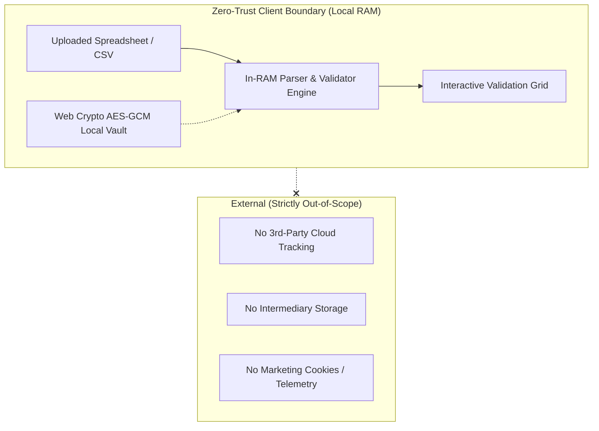

# Privacy Policy & Security Architecture

**Effective Date:** November 2026  
**Product:** Unravel Data Ingestion Platform  
**Architecture:** Zero-Trust Client-Side Only

---

## 1. Executive Summary

**Unravel** was engineered from the ground up under the principle of **Zero-Trust Client-Side Computing**. 

Unlike conventional software-as-a-service (SaaS) ETL tools, **Unravel never transmits, intercepts, inspects, or stores your tabular records, files, or credentials on external servers.** 

All file parsing, column mappings, data transformations, and validation checks occur **exclusively in the RAM of the user's local web browser**.

---

## 2. Key Architectural Guarantees

### 1. In-RAM Execution Only
When you open an Excel (`.xlsx`), CSV, or TSV file in Unravel, the file is read into memory using client-side JavaScript APIs (`FileReader`, SheetJS, and PapaParse). At no point is the raw file uploaded to an intermediary web server. When the browser tab is closed, the in-memory data is purged immediately by the browser engine.

### 2. Zero Telemetry & Zero Analytics
Unravel contains **no telemetry scripts, no third-party tracking pixels, no Google Analytics, and no marketing cookies**. The application does not collect device fingerprints, IP addresses, usage statistics, or user behavior metrics.

### 3. Fully Offline & Air-Gapped Friendly
All user interface dependencies (Bootstrap 5, SheetJS, PapaParse, SweetAlert2, Moment.js, and Bootstrap Icons) are bundled locally in the repository under `assets/vendor/`. The application makes zero CDN calls and requires no active Internet connection to function.

### 4. Client-Side Cryptographic Vault (Web Crypto AES-GCM)
When you save custom schema layouts or project configurations locally in your browser, Unravel allows you to encrypt the state using the **W3C Web Crypto API**:
- **Key Derivation**: PBKDF2 with SHA-256 and 100,000 iterations from your master passphrase.
- **Cipher**: AES-GCM 256-bit authenticated encryption.
- **Initialization Vector**: Cryptographically secure random 12-byte IV per encryption operation.
- **Storage**: Only the ciphertext and public salt are persisted to browser `localStorage`. Cleartext configurations are never stored unencrypted if the vault is active.

### 5. Explicit-Only API Dispatches
The only time Unravel makes an outbound network request is when you explicitly click **Dispatch Clean Payload to REST API** in Step 8. Even then:
- The request is dispatched directly from your browser (`fetch()`) to the endpoint **you** configured in your schema.
- Authorization Bearer tokens are kept in browser memory and passed directly to your designated destination endpoint.
- No intermediary proxy or tracking gateway is involved.

### 6. Optional Decryption Service Uses Cloud Transmission (Entirely Optional)
If you choose to utilize the optional Python FastAPI Decryption Gateway (`repos/unravel-service/unravel_service.py`) for password-protected Excel workbooks (`.xlsx`):
- **Cloud / Network Transmission**: When you submit a password to decrypt an encrypted file, the encrypted binary payload is transmitted over HTTP/HTTPS to the configured decryption service endpoint. In many enterprise deployments, this endpoint is hosted in the cloud or on a centralized remote server.
- **Entirely Optional**: **Using this decryption service is completely optional.** Standard, unencrypted Excel files (`.xlsx`), CSV files, and TSV files do not use or contact this service under any circumstances. They remain 100% inside your local web browser RAM.
- **In-Memory Decryption**: When the decryption gateway receives an encrypted file, it processes the byte stream strictly inside ephemeral Python `io.BytesIO` RAM buffers using `msoffcrypto-tool`. Decrypted bytes are returned directly to the browser and are never written to physical disk.
- **Alternative**: If you prefer never to use cloud decryption, you can remove password protection locally using Microsoft Excel or LibreOffice prior to uploading into Unravel.

---

## 3. Regulatory Compliance

### General Data Protection Regulation (GDPR) / UK GDPR
- **Privacy by Design (Article 25)**: Because Unravel does not collect, process, or store personal data on any server, organizations using Unravel maintain complete data sovereignty. No Data Processing Agreement (DPA) with third-party cloud providers is required to use this tool.
- **Data Minimization (Article 5(1)(c))**: Transformed data only retains the exact canonical fields defined by your schema.

### Health Insurance Portability and Accountability Act (HIPAA)
- Unravel can be safely utilized to process Protected Health Information (PHI) without requiring a Business Associate Agreement (BAA) with software vendors, because the software runs entirely on the covered entity's own endpoints or internal servers.

### California Consumer Privacy Act (CCPA / CPRA)
- Unravel does not "sell" or "share" consumer personal information as defined by California privacy law.

---

## 4. Verification & Auditing

Because Unravel is delivered as readable, unminified JavaScript and CSS, your organization's security team can easily audit the source code:
1. Open Developer Tools (`F12`) in any browser.
2. Navigate to the **Network** tab.
3. Upload a file, process data, and verify that **zero network requests** are dispatched during parsing and validation.

---

## 5. Contact & Support
For security questions or architecture reviews, consult your enterprise data governance team or review the project's open codebase.
