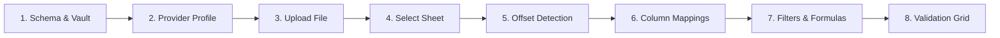

# Visual Walkthrough & Screenshots

This guide provides a visual walkthrough of Unravel's key interfaces across the Ingestion Runner, Developer Studio, and Companion Service.

---

## 1. Application Runner & Ingestion Stepper

The core wizard guides users through an 8-stage tabular ingestion process with real-time feedback:




- **Excel-Style Ribbon Header**: Project metadata, master vault status, help diagnostics, and clear-session actions.
- **Auto-Advance Guardrails**: When layout rules and column offsets match deterministically, Unravel automatically advances forward to save time.

---

## 2. Developer Studio

The Developer Studio (`builder/index.html` in `unravel-ui`) enables visual JSON schema authoring without manual coding:

### Target Columns Toolbar
Each canonical destination column is configured in a compact single-row toolbar:
```
[REQUIRED TOGGLE]  [Display Label]  [Default Value]  [(N) Validation]  [(N) Transformation]  [BIN ICON]
```
- **Required Toggle**: Switches between required constraints and optional fields.
- **Display Label & Default Value**: Inputs for UI headers and fallback values.
- **Validations Modal**: Attach regex, email, postal code, NHS modulus-11 checks, and numeric bounds.
- **Transformations Modal**: Build sequential pipelines including case conversions (`UPPERCASE`, `LOWERCASE`), whitespace stripping (`TRIM`), and type casting (`CAST_STRING`, `CAST_FLOAT`, `CAST_INTEGER`, `CAST_DATE`).

### Pre-Validation Ingestion Row Filters
- Define multi-condition filter rules using `=`, `!=`, `>`, `>=`, `<`, `<=` on numbers or text.
- Combine rules via `AND` or `OR` logic to filter raw records before entering validation.

### Calculated Virtual Columns
- Add dynamic virtual columns computed from bracketed tokens (e.g. `[sale_qty] * [sale_unit_price]` or ternary conditionals).

---

## 3. Interactive Validation Grid & Dual Export

- **Color-Coded Cells**:
  - Green / Default: Validated and normalized.
  - Yellow: Optional field validation failure with automatic fallback to `defaultValue`.
  - Red: Blocking validation error.
- **In-Cell Editing**: Double-click any cell to correct data in place; validation re-runs instantly in memory.
- **Bulk Row Deletion**: Checkbox selection for dropping irrelevant rows.
- **Dual Export Actions**:
  - **Clean Output**: Download normalized XLSX, RFC 4180 CSV, or structured JSON.
  - **Excluded Rows CSV**: Download an itemized `.csv` containing only excluded rows with an explicit column stating the reason for rejection.
